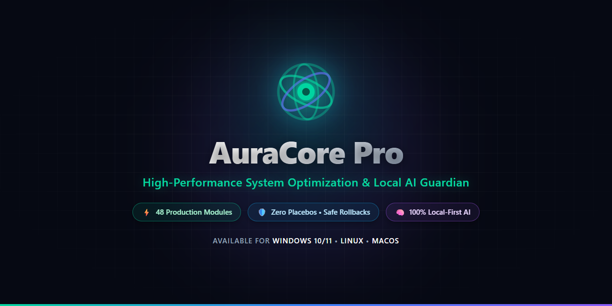

  

  
  
  
  

---

## What is AuraCore Pro?

AuraCore Pro is a desktop system optimization suite for Windows and Linux. It brings cleaning, performance tuning, privacy tools and system monitoring together in one app, plus AI features that run locally on your machine.

This repository hosts releases, release notes and the issue tracker. The source code is private.

---

## Features

### Cleaning & storage
Junk Cleaner, Disk Cleanup Pro, Privacy Cleaner, Storage Compression, Space Analyzer, File Shredder, and on Linux: Package, Journal, Kernel, Snap & Flatpak, and Docker cleaners.

### Performance
RAM Optimizer, Gaming Mode (auto-detects 68+ games), Startup Optimizer, Service Manager, Network Optimizer, DNS Benchmark, and on Linux: Swap Optimizer and Systemd Manager.

### Security & system tools
Defender Manager, Firewall Rules, Hosts Editor, Driver Updater, Registry Optimizer, Battery Optimizer, System Health, Disk Health (SMART), Process Monitor, Network Monitor and ISO Builder.

### AI (runs on your device)
- **AI Insights**: health score, CPU/RAM anomaly alerts, disk-full forecast and memory-leak detection.
- **AI Recommendations**: suggestions based on your live system data.
- **AI Chat** *(experimental)*: ask questions about your system using a local language model.

AI analysis happens on your computer. Sharing anonymous usage data is optional and asks for your consent first.

### Undo support
Many modules back up what they change before they change it, so you can roll back.

### Languages
English, Türkçe, Deutsch, Español, Français *(German, Spanish and French arrive in the next release)*.

---

## Download

Installers will be published on the [Releases](https://github.com/edutuvarna/AuraCorePro/releases) page.

- **Windows**: Windows 10 or 11, 64-bit.
- **Linux**: 64-bit (x86_64). Some modules need the AuraCore privilege helper.
- **macOS**: not available yet.

---

## Feedback

- Found a bug? [Open a bug report](https://github.com/edutuvarna/AuraCorePro/issues/new?template=bug_report.md).
- Have an idea? [Request a feature](https://github.com/edutuvarna/AuraCorePro/issues/new?template=feature_request.md).
- What changed in each version: [CHANGELOG.md](CHANGELOG.md).

---

## License

AuraCore Pro is proprietary software. All rights reserved. See [LICENSE.md](LICENSE.md).
